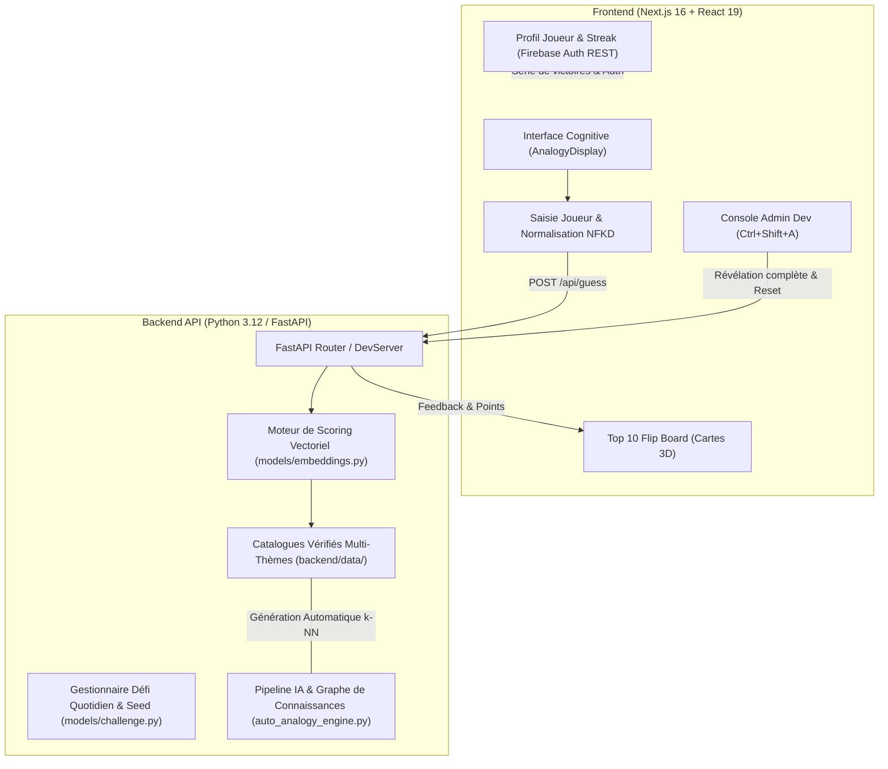

<div align="center">

# 🧠 VectorWord — AI Latent Space Analogy Game

**A semantic Word2Vec analogy game and $k$-NN latent search engine with a Family Feud flip board.**

[](https://github.com/Badrouuu/Guess-What/actions/workflows/ci.yml)
[](https://nextjs.org/)
[](https://react.dev/)
[](https://www.python.org/)
[](https://fastapi.tiangolo.com/)
[](https://numpy.org/)
[](https://www.typescriptlang.org/)
[](LICENSE)

[Architecture](#-architecture-syst%C3%A8me) • [Fondements Mathématiques & IA](#-fondements-math%C3%A9matiques--ia) • [Fonctionnalités Clés](#-fonctionnalit%C3%A9s-cl%C3%A9s) • [Installation & Démarrage](#-installation--d%C3%A9marrage) • [API Reference](#-api-reference) • [Tests Unitaires](#-tests-unitaires--qualit%C3%A9)

</div>

---

## 📌 Présentation du Projet

**VectorWord** est une application web d'ingénierie IA combinant l'algèbre linéaire des espaces sémantiques distribués (**Word2Vec / ConceptNet Numberbatch**) avec le dynamisme d'un plateau de jeu interactif inspiré d'*Une Famille en Or* (Family Feud) et les mécaniques d'engagement viral de *Wordle*.

Le joueur est confronté à une analogie sémantique :
$$\text{[ MOT\_A ] est à [ MOT\_B ] ce que [ MOT\_C ] est à [ ? ? ? ]}$$

Au lieu de se limiter à une vérification textuelle binaire, le moteur évalue chaque mot proposé en temps réel dans un **espace vectoriel dense à 50 dimensions** ($\mathbb{R}^{50}$) via une métrique de **similarité cosinus**. Le plateau dissimule un **Top 10** composé :
1. **La carte Jackpot (#1) :** La solution formelle de l'analogie ($\text{sim} \approx 0.98$, 1000 pts).
2. **Les 9 cartes Satellites (#2 à #10) :** Des concepts sémantiquement proches découverts par recherche des $k$ plus proches voisins ($k\text{-NN}$), qui récompensent l'intuition du joueur sans lui faire perdre de vies.

---

## 📐 Fondements Mathématiques & IA

### 1. Arithmétique Vectorielle d'Analogies (Mikolov et al.)
Dans un espace d'embeddings entraîné, les relations sémantiques sont encodées sous forme de **vecteurs de translation linéaires**.
Si deux paires $(A, B)$ et $(C, D)$ partagent la même relation relationnelle $\vec{r}$ (ex: $\text{capitale\_de}$, $\text{réalisateur\_de}$, $\text{héros\_de}$) :

$$\vec{v}(B) - \vec{v}(A) \approx \vec{r} \approx \vec{v}(D) - \vec{v}(C)$$

Pour prédire le mot mystère $D$, le moteur calcule le vecteur cible optimal $\vec{v}^*$ :

$$\vec{v}^* = \vec{v}(C) + \vec{v}(B) - \vec{v}(A)$$

$$\hat{v}^* = \frac{\vec{v}^*}{\|\vec{v}^*\|_2}$$

### 2. Métrique de Similarité Cosinus
La pertinence de toute réponse candidate $w \in \mathcal{V}$ est mesurée par son angle dans l'espace hypersphérique :

$$\text{similarity}(\hat{v}^*, \vec{v}_w) = \cos(\theta) = \frac{\hat{v}^* \cdot \vec{v}_w}{\|\hat{v}^*\|_2 \ \|\vec{v}_w\|_2}$$

### 3. Recherche des $k$ Plus Proches Voisins ($k\text{-NN}$) & Échantillonnage Négatif
Pour générer les cartes satellites (#2 à #10), le pipeline exécute une recherche des $k$-NN sous contraintes d'exclusion :

$$\mathcal{S}_{\text{top10}} = \arg\max_{w \in \mathcal{V} \setminus \{A, B, C\}}^k \Big( \cos(\hat{v}^*, \vec{v}_w) \Big)$$

### 4. Filtrage d'Isomorphisme et Détection d'Analogies Dégénérées
Afin d'éviter les analogies tautologiques (ex: *"Inception est à Nolan ce que Nolan est à ???"*), le moteur automatique `auto_analogy_engine.py` applique une **contrainte de cardinalité stricte** :

$$\text{Card}\big(\{A, B, C, D\}\big) = 4$$

Toute paire partageant une entité commune ($A = C$, $B = C$, ou $B = D$) est formellement rejetée par le graphe relationnel.

---

## 🏗️ Architecture Système



---

## ✨ Fonctionnalités Clés

- **🎯 Formulation Cognitive Naturelle :** Remplacement de la formule mathématique brute par la phrase relationnelle `[ MOT_A ] est à [ MOT_B ] ce que [ MOT_C ] est à [ ? ? ? ]` avec carte mystère dorée pulsante et bascule vers la formule vectorielle pour les passionnés.
- **💡 Système d'Indices Équilibré :**
  - **Masque de lettres automatique :** Débloqué dès la 1ère mauvaise réponse (`_ _ _ _ _ _ _ (X lettres)`).
  - **Déblocage de la 1ère lettre :** Accessible au coût de **2 vies** (`-2 ❤️`), sécurisé si le joueur a plus de 2 vies (`B _ _ _ _ _ _`).
- **♾️ Mode Entraînement Illimité :** Bascule instantanée entre le **📅 Défi du Jour** (seed mondial partagé via hachage déterministe SHA-256 de la date UTC) et le mode **♾️ Entraînement** avec bouton `🎲 Nouvelle analogie` pour rejouer à l'infini.
- **🌍 4 Univers Thématiques Dédiés :**
  - 🌍 **Culture G** : Capitales, monnaies, littérature, chefs-d'œuvre artistiques.
  - 🎮 **Gaming** : Héros de jeux, constructeurs, nemésis légendaires, genres.
  - 🎬 **Ciné & Séries** : Réalisateurs culte, acteurs emblématiques, univers de fiction.
  - 🍕 **Food & Gastro** : Spécialités nationales, ingrédients de base, métiers de bouche.
- **🔥 Profil Joueur, Streaks & Firebase Auth :** Séries de victoires consécutives, sélecteur parmi 12 avatars emojis, statistiques de précision, et intégration Firebase Auth (REST API) avec bascule transparente en stockage local si aucune clé n'est configurée.
- **🛠️ Console Développeur / Admin (`Ctrl+Shift+A`) :** Visualisation des vecteurs d'analogie, inspection du Top 10 officiel, révélation instantanée des cartes sur le plateau, réinitialisation des vies et déclencheur du pipeline de régénération IA.

---

## 📁 Structure du Répertoire

```text
Guess-What/
├── .github/
│   └── workflows/
│       └── ci.yml               # Pipeline CI GitHub Actions (Tests Python + Build Next.js)
├── backend/
│   ├── data/                    # Graphe de connaissances et catalogues vérifiés par IA
│   │   ├── knowledge_base.json
│   │   ├── verified_challenges_culture.json
│   │   ├── verified_challenges_gaming.json
│   │   ├── verified_challenges_cinema.json
│   │   └── verified_challenges_food.json
│   ├── models/                  # Algèbre vectorielle et gestionnaire de défis
│   │   ├── embeddings.py        # Calcul cosinus, normalisation Unicode NFKD, k-NN
│   │   └── challenge.py         # Déterminisme de date, cache mémoire, modes de jeu
│   ├── scripts/
│   │   └── auto_analogy_engine.py  # Pipeline IA 100% autonome de génération d'analogies
│   ├── tests/
│   │   └── test_vector_engine.py   # Suite de tests unitaires (Maths, invariants, déterminisme)
│   ├── dev_server.py            # Serveur autonome zéro-dépendance (Python standard)
│   ├── main.py                  # API FastAPI asynchrone pour production
│   ├── requirements.txt         # Dépendances Python (fastapi, uvicorn, numpy)
│   └── Dockerfile               # Conteneurisation Docker
├── frontend/
│   ├── app/
│   │   ├── globals.css          # Thème sombre Cyberpunk/Slate Tailwind v4
│   │   ├── layout.tsx
│   │   └── page.tsx             # Boucle de jeu principale, état global, audio/vies
│   ├── components/
│   │   ├── AnalogyDisplay.tsx   # Phraséologie cognitive & masque d'indices
│   │   ├── Top10Board.tsx       # Plateau 10 cartes 3D style Une Famille en Or
│   │   ├── GuessInput.tsx       # Champ de saisie avec thermomètre de proximité
│   │   ├── ProfileModal.tsx     # Profil joueur, avatars et connexion Firebase
│   │   ├── AdminModal.tsx       # Console Admin développeur (Ctrl+Shift+A)
│   │   ├── LivesBar.tsx         # Barre de cœurs atomique
│   │   ├── ScoreCounter.tsx     # Compteur de score animé
│   │   └── Timer.tsx            # Compte à rebours minuit UTC
│   ├── lib/
│   │   ├── api.ts               # Client HTTP typé TypeScript
│   │   └── firebaseAuth.ts      # Connecteur Firebase REST API & stockage local
│   ├── package.json
│   └── tsconfig.json
├── .gitignore                   # Exclusion stricte des secrets, node_modules et caches
├── LICENSE                      # Licence MIT
└── README.md
```

---

## 🚀 Installation & Démarrage

### Prérequis
- **Python** 3.11+ avec `pip`
- **Node.js** 20+ avec `npm`

---

### 1. Cloner le Dépôt
```bash
git clone https://github.com/Badrouuu/Guess-What.git
cd Guess-What
```

---

### 2. Démarrer le Backend Python

```bash
cd backend

# Option A : Serveur autonome de développement (zéro installation externe hors numpy)
python dev_server.py

# Option B : Serveur de production FastAPI avec rechargement automatique
pip install -r requirements.txt
uvicorn main:app --reload --port 8000
```
Le serveur démarre sur `http://localhost:8000`.

---

### 3. Démarrer le Frontend Next.js

Dans un nouveau terminal :
```bash
cd frontend

# Installation des dépendances
npm install

# Lancement du serveur de développement Turbopack
npm run dev
```
Ouvre [http://localhost:3000](http://localhost:3000) dans ton navigateur.

---

## 🧪 Tests Unitaires & Qualité

Une suite de tests unitaires valide l'intégrité mathématique de l'espace vectoriel et les invariants du catalogue :

```bash
cd backend
python -m unittest tests/test_vector_engine.py -v
```

**Sortie attendue :**
```text
test_analogy_vector_arithmetic (tests.test_vector_engine.TestVectorMath) ... ok
test_cosine_similarity_properties (tests.test_vector_engine.TestVectorMath) ... ok
test_all_themes_loaded (tests.test_vector_engine.TestCatalogIntegrity) ... ok
test_non_degeneracy_invariant (tests.test_vector_engine.TestCatalogIntegrity) ... ok
test_top10_board_structure (tests.test_vector_engine.TestCatalogIntegrity) ... ok
test_daily_challenge_determinism (tests.test_vector_engine.TestGameMechanics) ... ok
test_training_mode_diversity (tests.test_vector_engine.TestGameMechanics) ... ok

----------------------------------------------------------------------
Ran 7 tests in 0.363s

OK
```

---

## 📡 API Reference

### `GET /api/challenge`
Récupère le défi actif (quotidien ou entraînement) avec Top 10 masqué pour éviter tout spoil côté client.
- **Query params :** `lang` (défaut: `fr`), `theme` (`culture`, `gaming`, `cinema`, `food`), `mode` (`daily`, `training`), `seed` (optionnel).
- **Réponse :**
```json
{
  "id": "auto_cinema_001",
  "theme": "cinema",
  "word_a": "Inception",
  "word_b": "Nolan",
  "word_c": "Pulp Fiction",
  "category": "realisateur de",
  "difficulty": 2,
  "answer_length": 9,
  "first_letter": "T",
  "top10": [
    { "rank": 1, "points": 1000, "revealed": false },
    { "rank": 2, "points": 800, "revealed": false }
  ],
  "total_possible_points": 4200
}
```

### `POST /api/guess`
Évalue la proposition d'un joueur en calculant sa similarité cosinus avec le vecteur cible.
- **Body :**
```json
{
  "guess": "Tarantino",
  "lang": "fr",
  "theme": "cinema",
  "challenge_id": "auto_cinema_001",
  "session_id": "usr_948201"
}
```
- **Réponse :**
```json
{
  "in_top10": true,
  "rank": 1,
  "points": 1000,
  "similarity": 0.98,
  "feedback": "exact",
  "revealed_word": "tarantino"
}
```

### `GET /api/reveal-top10`
Révèle l'intégralité des 10 cartes secrètes à la fin de la partie ou dans la console Admin.
- **Query params :** `lang`, `theme`, `challenge_id`.

---

## 🛠️ Stack Technologique & Compétences

| Domaine | Technologies | Rôle dans le projet |
| :--- | :--- | :--- |
| **NLP & Machine Learning** | Python 3.12, NumPy, ConceptNet Numberbatch | Algèbre des espaces vectoriels denses, recherche $k$-NN, similarité cosinus, extraction de graphes relationnels |
| **Backend & API** | FastAPI, Uvicorn, ThreadingHTTPServer, Pydantic | API REST asynchrone, validation de schéma, rate-limiting par IP, hachage pseudo-aléatoire déterministe (SHA-256) |
| **Frontend & UI/UX** | Next.js 16 (App Router), React 19, TypeScript, Tailwind CSS v4 | Rendu SSR/hybride haute performance, state management réactif atomique, animations de retournement 3D |
| **Auth & Stockage** | Firebase Identity Toolkit (REST API), LocalStorage | Authentification sans friction, suivi des victoires consécutives (Streaks), synchronisation de profil |
| **DevOps & QA** | GitHub Actions, Unittest, Docker, Git | Intégration continue (CI), validation des invariants mathématiques, compilation de production |

---

## 📄 Licence

Ce projet est sous licence **MIT** — voir le fichier [LICENSE](LICENSE) pour plus de détails.

---

<div align="center">
  <b>Conçu avec passion pour l'ingénierie IA, le Traitement Automatique du Langage Naturel (NLP) et les mathématiques des représentations distribuées.</b>
</div>
